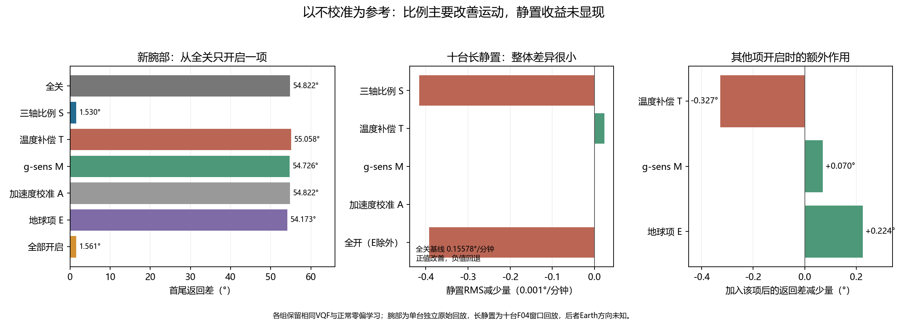

# 以不校准为参考：各项校准对静置和返回误差的作用

2026-11-13。使用当前已安装参数，固定生产融合算法，在新腕部录制上完成五项开关的 **32 组组合**；另用已有十台独立长静置数据，各完成 16 组非 Earth 组合。没有重新求参、写设备或改固件。

**三轴比例是本次运动返回误差下降的主要来源：54.822° → 1.530°，降低 97.21%。** 全部开启为 1.561°，降低 97.15%。温补在此轨迹中使返回差略增，g-sens 和 Earth 有较小改善。十台长静置的全关基线为 0.155784°/分钟，各项开关的总体差异均小于 0.3%，没有显示明显净收益。

## 基线与共同条件

这里“不校准”明确指**关闭已保存的校准补偿**：`S=1，T=0，M=0，A=I，b=0，E=0`。各组均保留相同 VQF、加速度观测门控和正常静止／运动零偏学习；滤波器只在录制起点初始化一次。不通过关闭正常零偏学习来人为抬高基线，不在每个静置段重新归零，不用返回结果拟合参数。

降低比例为 `(基线−开启后)/基线`。绝对减少量为正表示改善，为负表示回退。各组相同输入、采样时序与端点；单项效果不能相加。

## 运动放回：从全关只开启一项

使用新录制 `capture-20261113-170859.slimecap`，0 号、84,861 个实际唯一样本，约 207 秒。操作者确认仅最后返回，回位差小于 0.5°，且开机和录制起点与地球校准时保持相同摆放／地理方向。因此 E 直接使用身份匹配快照的固定参考，没有扫描方向或选最小返回结果。

固定首窗口 5–22 秒、末窗口 185–205 秒，指标为平均四元数间的最短旋转角。全关基线 **54.821652°**。

| 开启条件 | 返回差（°） | 相对全关绝对减少（°） | 相对全关变化 |
|---|---:|---:|---|
| 全关 | 54.821652 | 0 | 基线 |
| 仅三轴比例 S | 1.529678 | +53.291974 | 降低97.21% |
| 仅温度补偿 T | 55.058278 | -0.236626 | 增加0.43% |
| 仅g-sens M | 54.725915 | +0.095737 | 降低0.17% |
| 仅加速度校准 A | 54.821652 | +0.000000 | 降低0.00% |
| 仅地球项 E | 54.172595 | +0.649057 | 降低1.18% |
| 全部开启 | 1.560700 | +53.260952 | 降低97.15% |

这个百分比是本段原始输入回放的返回差降低，并非所有穿戴动作的精度改善。返回差还包含小于 0.5° 的物理回位不确定性。该文件没有在线四元数与完整滤波历史，回放不是实机输出逐位复原。

录制的 58 个乱序按发射端序号恢复，10 个缺样只在动作后的静置。沿用已核验的显式静置补全及原发射端时间；未压缩缺口。主静置统计避开缺口。旧[无 Earth 对照](WRIST_RETEST_20261113_zh.md)为 1.785°，本次有了操作者方向确认后，加入固定 E 得到 1.561°。

## 长静置：十台各约 25 分钟

使用此前未参与参数拟合的独立静置录制，选取已确认电池供电后的发射端第 915 秒至结束，每台约 1517–1519 秒。每组从段首初始化，排除前 15 秒，再计算**非重叠五秒姿态增量率的 RMS**，单位°/分钟；十台等权 RMS 聚合。它是短时增量统计，不能乘以 60 当作每小时累计漂移预测。

这份旧长静置录制的地理朝向没有确认，本次关于方向的回答只适用于新腕部，不能追溯套用。因此本表 E 保持关闭；Earth 的同段静置对照单列在下一节。

| 开启条件 | 静置RMS（°/分钟） | 绝对减少（°/分钟） | 相对全关变化 |
|---|---:|---:|---|
| 全关 | 0.15578403 | 0 | 基线 |
| 仅三轴比例 S | 0.15620002 | -0.00041599 | 增加0.2670% |
| 仅温度补偿 T | 0.15576039 | +0.00002364 | 降低0.0152% |
| 仅g-sens M | 0.15578269 | +0.00000135 | 降低0.0009% |
| 仅加速度校准 A | 0.15578403 | +0.00000000 | 降低0.0000% |
| 全开，E除外 | 0.15617656 | -0.00039253 | 增加0.2520% |

比例略微改变噪声尺度；温补／M 在恒定姿态、窄温变化下提供的修正，部分已经被在线零偏学习吸收。当前结果不支持“这些项必然降低静置姿态漂移”的说法。温补有 4 台略好、6 台略差；g-sens 有 7 台略好、3 台略差，数值都很小，不作统计显著性或长期净收益声明。

长静置是 F04 原始积分窗均值，按设备窗口时长保守重采样，再以相同 400/100 Hz 更新节拍重复均值。它没有恢复原始高频噪声、实时温度平滑或每个 gyro/accel 标签的顺序。静置与运动两张表来自不同录制，各自在同一数据内比较，不跨表相加百分比。

## 新腕部动作前的短静置，包括 Earth

为同一录制的五项完整对照，另统计动作前 10–20 秒的两个五秒增量。全关为 **0.10727682°/分钟**。仅 10 秒支持不足以判断长期静置收益，尤其不能替代上面的长静置结果。

| 开启条件 | 动作前静置RMS（°/分钟） | 相对全关变化 |
|---|---:|---|
| 仅三轴比例 S | 0.10737676 | 增加0.0932% |
| 仅温度补偿 T | 0.10361595 | 降低3.4125% |
| 仅g-sens M | 0.10707149 | 降低0.1914% |
| 仅加速度校准 A | 0.10727682 | 降低0.0000% |
| 仅地球项 E | 0.10728348 | 增加0.0062% |

Earth 的这一静置差别接近数值敏感度；CMSIS 与 libm 对该极小变化的正负也会不同，应解读为**未见可辨静置收益**。不要引用旧报告融合前角速度残差的“Earth 降低 22.20%”，填到这张 VQF 姿态漂移表中。

另外保留动作后 190–205 秒的姿态变化作为“恢复过程”诊断：全关约 10.29°/分钟，校准后约 0.45°/分钟。全关在该窗口仍在纠正运动期间积累的倾斜，这不是纯静置慢漂。此数值明确排除在上面静置收益表之外，避免把运动恢复误报成静置改善约 96%。

## 其他项都开时，再加入某一项

这张表的基线是“只缺该项”，与从全关只开一项的基线不同。用于检查相互作用，不相加，也不按这份单一检验轨迹选择开关后立即部署。

| 再加入的项 | 返回差，关闭该项 → 全开（°） | 绝对减少（°） | 变化 |
|---|---:|---:|---|
| 三轴比例 S | 54.313799 → 1.560700 | +52.753099 | 降低97.13% |
| 温度补偿 T | 1.234072 → 1.560700 | -0.326627 | 增加26.47% |
| g-sens M | 1.631023 → 1.560700 | +0.070323 | 降低4.31% |
| 加速度校准 A | 1.560700 → 1.560700 | +0.000000 | 降低0.00% |
| 地球项 E | 1.785149 → 1.560700 | +0.224449 | 降低12.57% |

其中 E：1.785149° → 1.560700°，额外减少约 0.224449°／12.57%；温补：1.234072° → 1.560700°，反而增加约 0.326627°／26.47%。这只是固定轨迹和当前温表的结果，不能由此断言整体关闭温补更好。应补重复升降温、不同速度／方向的独立证据；当前参数保持不变。

## 加速度项为何为零

本次十台读回的已安装加速度变换均为单位矩阵、零偏移，开关没有改变输入，因此返回差与静置统计逐位相同。这说明**当前没有非平凡的已安装加速度校正可对照**；不说明实际六面校准没有用。此前单独拟合的加速度候选没有写入，本轮不拿候选冒充当前安装值。

## 长静置逐台结果

| 设备 | 全关 | 仅S | 仅T | 仅M | 全开，E除外 |
|---|---:|---:|---:|---:|---:|
| 0 | 0.139483 | 0.140046 | 0.139516 | 0.139480 | 0.140072 |
| 1 | 0.181547 | 0.180972 | 0.181590 | 0.181547 | 0.181015 |
| 2 | 0.135646 | 0.136053 | 0.135704 | 0.135637 | 0.136105 |
| 3 | 0.169904 | 0.170839 | 0.169861 | 0.169907 | 0.170796 |
| 4 | 0.118962 | 0.119298 | 0.119019 | 0.118961 | 0.119360 |
| 5 | 0.208247 | 0.208898 | 0.207993 | 0.208246 | 0.208642 |
| 6 | 0.161146 | 0.161923 | 0.160992 | 0.161145 | 0.161770 |
| 7 | 0.157515 | 0.157920 | 0.157592 | 0.157506 | 0.158006 |
| 8 | 0.140090 | 0.140530 | 0.140260 | 0.140097 | 0.140700 |
| 9 | 0.122806 | 0.123076 | 0.122689 | 0.122808 | 0.122957 |

单位均为°/分钟。全部零偏学习设置相同，参数来自各自身份匹配的当前快照，不向其他设备套用 0 号系数。

## 验证与复现

原始 `.slimecap`、F04 HID 报告、现有数组和快照均保持不变，源文件、私有分析、生产核心与数值库有 SHA-256。独立校验逐帧检查旧 F04 的 CRC／会话／发射端时序，并从原始整数积分重新核对十台缓存的 gyro、accel、温度、时长；新腕部的 84,861 个观察已在上一轮独立核对。本轮另复核四元数、32 组开关、160 组长静置报告、正负百分比和聚合公式。

7 组主要腕部对照使用 CMSIS 复核，返回差与 libm 最大差约 **0.0030°**。另对 0 号长静置的全关、单开 S/T/M、全开非 E 做 CMSIS 检查。小到接近数值差异的变化，不宣称实机净收益。

完整脱敏数值见[结构化结果](data/calibration-ablation-20261113.json)。本机脚本在 `.local/calibration-ablation-20261113/`：`run.py` 计算新腕部 32 组，`long_static.py` 计算独立长静置，`verify.py` 从原始 F04 与数组核对，`report.py` 生成本报告。私人原始数据不公开，摘要哈希绑定维护者原件，不能替代原件复算。本轮为只读分析，没有刷机、写参数或变更融合算法。
