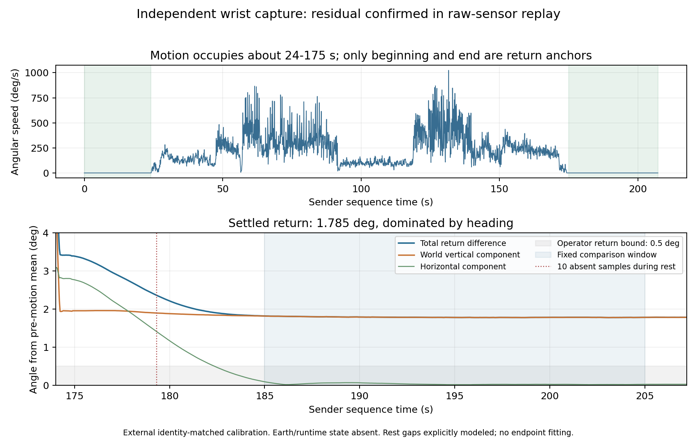

# 新腕部录制：可继续使用，航向残差尚未解决

后续补充：操作者已确认这次开机和录制初始方向与地球校准相同。[相对不校准的逐项消融](CALIBRATION_ABLATION_20261113_zh.md)因此增加固定 E 对照，当前全开返回差为 1.561°；本页保留先前关闭 Earth 的 1.785° 分析和来源限制。

这份 `capture-20261113-170859.slimecap` 可以使用，**目前不用重录**。操作者确认只有最后一次返回初始位置，实际回位差小于 0.5°。按固定首尾静置窗口、当前已安装校准进行生产核心回放，返回差 **1.785°**，竖直旋转分量 **1.785°**，主要是航向残差。

在操作者给出的回位界限成立时，这个回放结果的累计姿态误差界限约为 **1.29–2.29°**。该界限只扣除了物理回位不确定性，没有覆盖校准快照、时钟、温度与 Earth 初始化的模型差异；不是实机绝对精度置信区间。本轮没有修好剩余误差。

## 录制完整性与处理口径

- 保存 84,861 个唯一陀螺样本，发射端序号跨度约 207.202 秒。开头约 0–24 秒静置，动作约 24–175 秒，末尾约 175–207 秒静置；没有发现中间长静置，也没有把运动中的临时姿态当作返回约束。
- 58 个乱序样本，最大落后 24 个序号，按发射端序号恢复。发生一次 16 位序号回绕，无重复冲突、无明确重启／不连续标记。时间为序号除以元数据标称 409.60004 Hz；接收器到达时间只作时长一致性检查，不参与逐样本积分。
- 缺失 10 个陀螺样本，其中还缺 2 个新鲜加速度标签，共约 24.4 毫秒，均在 179.29–179.34 秒静置期间。没有把缺口压缩掉。报告明确补齐静置支持，并分别采用过去值保持和线性插值检查敏感度；这不代表原录制无缺口，也不是对运动缺样的通用处理。
- 固定首窗口为 5–22 秒、末窗口为 185–205 秒，避开启动与急停后的倾斜恢复。9 组静置窗口检查为 **1.777–1.816°**。重力方向前后仅差 **0.018°**，可核对倾斜重复性，不能验证航向。
- 缺口两种处理的最终返回差只相差 **0.000240°**，全轨迹差最大 **0.000763°**。没有迹象表明这 10 个静置缺样能解释 1.79°。

## 校准与实机输出的边界

录制 RF 身份匹配本机刷机后保存的 **0 号**完整快照；旧腕部数据对应 6 号。因此旧录制的 2.05° 和本次 1.79° **不能当成同一台前后改善比例**。新录制没有完整内嵌校准快照，这里明确引用身份匹配的外部快照，前提是录制前未另改设备参数。参数从旧快照冻结，没有用新腕部返回拟合比例、零偏或强制回零。

录制仅含原始 IMU 和基础元数据，没有固件四元数输出、当时 Earth 启用状态、世界参考及完整运行历史。主对照关闭 Earth，直接使用录制温度与快照 LUT，不能逐位重建当时在线状态。因此这里确认的是**当前校准下的独立原始数据回放残差**，没有证明设备在线输出恰好等于 1.79°。接收警告中“校准快照不完整”正是这一限制，不需要因此丢弃运动数据。

## 对照结果与已排除的简单修法

| 冻结处理条件 | 返回差（°） |
|---|---:|
| 当前比例，在线学习零偏 | 1.529678 |
| 当前比例、温表、M、加速度矩阵 | 1.785149 |
| 相同完整补偿，CMSIS数学路径 | 1.782489 |
| 完整补偿，关闭运动偏置学习 | 1.784990 |
| 完整补偿，关闭角速度加速度门控 | 1.735698 |

静置学习在首末窗口均成立；动作段被判断静止的比例约 0.0065%，关闭运动偏置学习只改变约 0.000159°，不支持把主要残差归于运动被大量当成静止。关闭加速度门控后仍约 1.74°。这些开关不能消除本次残差。

纯陀螺双精度积分减去起始静置零偏后，竖直残差约 1.91°；两种瞬时点采样积分敏感度约 ±0.04°。用未来末端静置偏置插值的非因果诊断也未消除竖直残差，不能作为在线算法。当前温表单独在本段把比例对照 1.530° 变为 1.855°，M 后约 1.785°；单次新轨迹的这点差别不足以决定整体关闭温补。

另外，利用已有三轴正反 20 圈记录、假定运动轴始终等于静置重力方向，独立估计完整陀螺 3×3 矩阵；新腕部没有参与拟合。该方案把新腕部回放恶化到约 11.60°，正向／反向单独训练也均超过 11°，因此拒绝采用。静置轴向、运动中的晃动和真实轴不正交不能仅凭这项假设分开。

## 下一步

保留这份独立腕部录制和当前设备参数。约 150 秒动作覆盖累计约 36,148° 的角速度路径，这不是已知角度真值；它说明本次对很小的系统误差很敏感。当前每轴比例相对扰动 0.01%，此回放可改变约 0.17–0.20°，优先核查独立比例精度、轴间耦合、动态测量和时钟／温度状态，而不是继续加快静止学习。

现有文件足够保留为独立检验集；无须马上再做相同腕部录制。后续若要识别具体动态项，应使用有已知角度、不同速度与正反方向的独立约束；若要核对当前在线输出，则需要同步记录姿态及 Earth 状态。这两件事各自补充缺失信息，不能靠把本次末端拟合到零替代。本轮没有设备写入或固件改动。

## 复现与验证

私人脚本和输入绑定保存在 `.local/wrist-retest-20261113/`，公开摘要见 [结构化结果](data/wrist-retest-20261113.json)。分析入口是 `analyze.py`，敏感度为 `diagnostics.py`，旧校准矩阵反例为 `axis_model.py`；它们均只读设备文件，不打开设备。源录制、快照、生产核心和所用本机库有 SHA-256。独立复核另外从原始 JSON 逐行恢复序号，核对未改写真实样本、加速度标签、缺口位置、首尾静置和来源哈希。私人原件没有公开时，摘要哈希只绑定本机原件，不构成外部复算数据。
