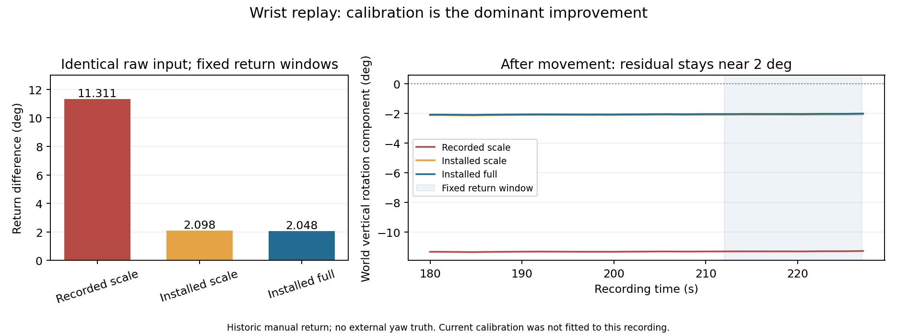

# 腕部返回误差：已定位主要来源，剩余误差待独立复测

后续已收到[2026-11-13 新腕部录制](WRIST_RETEST_20261113_zh.md)：操作者回位差小于 0.5°，当前校准下关闭 Earth 的回放返回差约 1.785°，残差仍在。新录制对应另一台设备，不能与本页旧录制直接计算改善百分比。本页保留历史数据归因。

2026-11-13 复核：先前 **11.31° 使用了 10 月 29 日的旧比例**。把同一物理传感器今天已经安装的比例用于相同原始输入，返回差为 **2.098°**；再加入当前温表、重力敏感度和加速度坐标，约 **2.048°**。相对旧比例回放减少 **81.9%**。这些参数已在上一轮写入并完成重启保持验证，本次没有改写设备参数或固件。

这说明三轴比例是这段旧录制大误差的主要可修正项。它没有证明当前实机重做动作也一定达到 2.05°，剩余约 2° 尚未解决。手工返回没有外部航向真值。



## 相同数据的逐项对照

旧原始录制共 93,056 个陀螺样本，标称 409.6 Hz。前端点固定为录制第 87–107 秒，后端点固定为第 212–227 秒；两者均通过静置一致性检查。比例来自后续三轴正反连续校准，不是用这次腕部返回拟合出来。

| 固定处理条件 | 返回差（°） |
|---|---:|
| 旧录制比例 + 当前低通 | 11.310996 |
| 当前已安装比例 + 当前低通 | 2.098051 |
| 当前已安装比例、温表、M、加速度矩阵 | 2.048070 |
| 相同完整补偿 + CMSIS | 2.048540 |
| 相同完整补偿，关闭运动偏置学习 | 2.049200 |
| 相同完整补偿，关闭角速度加速度门控 | 2.057359 |

各行使用同一生产滤波实现和同一端点。旧比例对照不包含原固件完整温表及初始运行状态，因此它是校准项诊断，不是逐位复现旧设备输出。旧报告 11.310730° 的后端点一直取到文件末尾 227.188 秒，本报告固定到 227 秒后为 11.310996°；这个微小差异不影响归因。

本次完成以下核对：

- 通过录制相邻 `before-info.txt` 的 RF 身份与本次快照绑定；不靠接收器槽位猜测设备。原始串口文件、CSV、快照及元数据均有输入哈希。
- 当前 S/M/E、温表和加速度矩阵来自刷机后的实际读回。所有系数在回放前冻结，未对这次腕部数据拟合、搜索或选参。
- 完整补偿为 `(g_raw-T-M*a_cal)*S`，`a_cal=A(a_raw-b)`。M 只使用最近的过去加速度样本；缺失标签仍缺失，不插值未来数据。
- 全部对照关闭 Earth：这份旧录制没有可靠的地理朝向记录，不能直接套用今天的 Earth 参考。
- 改变前后静置窗口的 9 组检查为 2.047–2.084°，不是只挑一个较好的端点。前后重力方向差约 0.025°；这能检查倾斜重复性，不能证明航向重复。

## 为什么暂不再改融合器

关闭运动偏置学习只改变约 0.0011°，关闭角速度门控也没有改善这段数据。双精度纯陀螺积分仍存在接近 2° 的竖直分量残差；在“瞬时点采样”的假设下，梯形／Magnus 对照变化仅约 0.01°，不支持把剩余误差主要归于数值积分。真实 IMU 的硬件滤波与采样相位尚未标定，因此这些公式只是敏感度检查。

当前三轴比例分别扰动 0.1%，这份录制的返回差可变约 0.4–0.6°。残余比例误差、轴不正交、动态测量误差、地球项与人工回位偏差均可能贡献；只有一个已知返回约束不足以分离它们。把比例调到本次恰好回零会把这份检验数据变成拟合数据，无法保证正反或另一速度仍有效。

已知真值单轴整圈测试中，生产滤波器在急停后仍有约 0.10° 的偏置低通尾迹。本轮工具保留并测试这个现象，它远小于旧腕部的 11°，也不足以单独解释剩余 2°。

## 继续压低剩余误差的最少动作

优先只选一台保持当前已验证的 S/M/E 和温表，使用有明确航向止挡／固定边线的回位参考。每次起止静置至少 20 秒：先慢速约 10 次、再快速约 10 次、最后约 50 次混合腕部动作，各做正反并重复。记录温度、真实动作次数和完整输入；不要改参数后与另一条轨迹直接比较。

若残差随次数或速度稳定累积，再用独立的已知角度数据校准比例／非正交或动态项，并在留出速度和反方向检验。若残差不随运动累积、但人工回位重复性差，应先改善固定参考。全部复测在当前已刷入固件上即可进行。

## 复现工具与验证

新增 `tools/compare_motion_calibration.py`，只读取已有文件。输入格式 `RAW_MOTION_COMPARE1` 包含标称采样率、固定返回窗口、人工返回声明、录制 USB 身份，以及 `files` 中 serial/csv/summary/progress/info/recorded_scale/snapshot/metadata 的路径和 SHA256。真实身份、参数和原始录制保留在本地 `.local/wrist-fix-20261113/`；公开摘要不包含这些值。

```powershell
python tools/compare_motion_calibration.py --input .local/wrist-fix-20261113/input.json --out .local/wrist-independent-replay
python -m unittest discover -s tests -p test_motion_calibration.py -v
```

9 项新测试与 13 项原有融合回放测试通过，涵盖错设备／快照哈希拒绝、加速度坐标、因果补偿、温区拒绝、端点运动检查，以及已知角度合成输入。结构化摘要见 [wrist-return-20261113.json](data/wrist-return-20261113.json)。旧固件镜像和原验证记录均保留历史内容。
